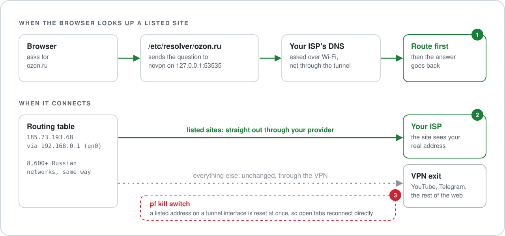

<p align="center"><a href="README.md">English</a> · <b>Русский</b></p>

<p align="center">
  <picture>
    <source media="(prefers-color-scheme: dark)" srcset="assets/banner-dark.svg">
    <source media="(prefers-color-scheme: light)" srcset="assets/banner-light.svg">
    
  </picture>
</p>

<p align="center">
  <b>Озон пишет «Что-то с интернетом», Wildberries просит отключить VPN, а без VPN не работает всё остальное.</b><br>
  novpn пускает нужные сайты мимо VPN, не выключая его. Небольшая служба для macOS.
</p>

<p align="center">
  
  
  
  <a href="https://github.com/Argona7/novpn/actions/workflows/tests.yml"></a>
  <a href="LICENSE"></a>
</p>

<p align="center">
  <a href="#установка">Установка</a> ·
  <a href="#команды">Команды</a> ·
  <a href="#режим-вся-россия">Вся Россия</a> ·
  <a href="#как-это-работает">Как работает</a> ·
  <a href="#безопасность">Безопасность</a> ·
  <a href="#вопросы">Вопросы</a>
</p>

<p align="center">
  
  <br>
  <sub>Настоящая запись с включённым VPN. Адреса заменены на документационные (<a href="assets/demo.tape">сценарий записи</a>).</sub>
</p>

## Зачем

С апреля 2026 года большинство крупных российских сервисов (Озон, Wildberries, Яндекс, VK, Сбер, Т-Банк, Госуслуги) ограничивают тех, у кого адрес похож на VPN ([Медуза](https://meduza.io/feature/2026/04/15/krupneyshie-rossiyskie-servisy-perestayut-rabotat-pri-vklyuchennom-vpn-kak-i-trebovalo-mintsifry)). Озон показывает «Что-то с интернетом», Wildberries просит отключить VPN, приложение Госуслуг не открывается.

Выключать VPN ради одной покупки значит ломать всё остальное, для чего он нужен. А сами VPN-программы на Маке тут не помогают: у Tailscale [нет раздельного туннелирования на macOS](https://github.com/tailscale/tailscale/issues/13677), а клиенты на Xray настраиваются наборами правил, после каждой правки требуют переподключения и оставляют открытые вкладки на старом пути.

**novpn** работает поверх того VPN, который у вас уже есть. Вы называете сайты, их трафик идёт через обычное подключение, всё остальное остаётся в туннеле.

## Главное

- **Одна команда на сайт.** `novpn add ozon.ru` захватывает все поддомены. Можно вставить ссылку целиком или домен на кириллице.
- **Режим «вся Россия».** `novpn russia on` пускает мимо VPN все 8 600+ российских сетей IPv4 и зоны `.ru`, `.рф`, `.su`.
- **Мгновенно.** Изменение применяется примерно за 0,3 с. Соединение, которое браузер уже держал через VPN, сбрасывается и меньше чем через секунду восстанавливается напрямую, так что открытые вкладки переключаются сами.
- **Без утечек.** Правило встроенного фильтра macOS (pf) не выпускает ни один адрес, который novpn направил напрямую, ни через что, кроме вашего физического подключения, так что он не может случайно вернуться в VPN. В режиме «вся Россия» отклоняется и IPv6 к российским сетям, который пошёл бы в туннель, и браузер сразу переходит на IPv4.
- **Не ломается в жизни.** Смена Wi-Fi, сон, `route flush` и падения учтены, маршруты проверяются каждые 2 секунды. `--uninstall` убирает всё, что было добавлено, кроме вашего списка сайтов.
- **Без зависимостей.** Около 1 900 строк на стандартной библиотеке Python, которая уже есть в macOS, и 92 теста.

## Быстрый старт

```bash
git clone https://github.com/Argona7/novpn.git && cd novpn
sudo ./install.sh          # один раз: ставит фоновую службу
novpn add ozon.ru          # этот сайт теперь мимо VPN
novpn check ozon.ru        # проверка: «en0 ... direct»
```

> [!IMPORTANT]
> **После `novpn add` один раз удалите cookie сайта.** Озон и другие сайты запоминают, что видели VPN, и продолжают блокировать, даже когда трафик уже идёт напрямую. В Chrome откройте `chrome://settings/content/all?searchSubpage=ozon.ru` и удалите данные сайта, в Safari: Настройки > Конфиденциальность > Управлять данными веб-сайтов. `novpn add` сам печатает такие ссылки для каждого добавленного сайта.

## Установка

> [!IMPORTANT]
> `install.sh` ставит службу launchd с правами root: менять маршруты, `/etc/resolver` и pf может только root. Что она трогает, перечислено в разделе [Безопасность](#безопасность), подробности в [SECURITY.md](SECURITY.md).

**Что нужно**

- macOS с `/usr/bin/python3` (он входит в Command Line Tools: `xcode-select --install`). Проверено на macOS 26.
- VPN, который работает как системный туннель (см. [С какими VPN работает](#с-какими-vpn-работает)).

**Установка и обновление**

```bash
git clone https://github.com/Argona7/novpn.git && cd novpn
sudo ./install.sh
```

Служба запускается из копии в `/usr/local/lib/novpn`, которой владеет root. Команда `novpn` ставится ссылкой из этой папки в `~/.local/bin`, поэтому папку не удаляйте (если оболочка не находит команду, добавьте `~/.local/bin` в `PATH`). Обновить: `git pull && sudo ./install.sh`.

**Удаление**

```bash
sudo ./install.sh --uninstall
```

Удаляет службу, её маршруты, правила pf, файлы в `/etc/resolver`, состояние, журнал, скачанный список сетей и ссылку на команду `novpn`. Ваш список сайтов `~/.config/novpn/domains.txt` остаётся.

## Команды

| Команда | Что делает |
|---|---|
| `novpn add <сайт>…` | Пустить сайты мимо VPN. Сайт захватывает все свои поддомены; подойдут и `https://www.ozon.ru/…`, и `кремль.рф`. |
| `novpn rm <сайт>…` | Вернуть сайты в VPN. |
| `novpn ls` | Показать список. |
| `novpn russia on` / `off` | Все российские сети и `.ru` `.рф` `.su` мимо VPN или обратно. |
| `novpn check <сайт>…` | Показать, куда сейчас уходит каждый IPv4-адрес сайта: `direct` (напрямую) или `VPN`. |
| `novpn status` | Служба, подключение, маршруты, режим «вся Россия», фильтр, текущий exit node Tailscale. |
| `novpn logs` | Журнал службы. |

Список хранится в обычном текстовом файле `~/.config/novpn/domains.txt`, по сайту в строке. Его можно править руками: служба замечает изменения за четверть секунды.

```console
$ novpn add gosuslugi.ru https://www.wildberries.ru/
+ gosuslugi.ru  (and *.gosuslugi.ru)
+ wildberries.ru  (and *.wildberries.ru)
applied in 0.3 s; open tabs switch over by themselves (reload one that still sees the VPN)

$ novpn check ozon.ru            # с включённым режимом «вся Россия»
ozon.ru: listed as ozon.ru
  185.73.193.68   en0 via 192.168.0.1  direct  (Russian network)
  185.73.194.82   en0 via 192.168.0.1  direct  (Russian network)
```

## Режим «вся Россия»

```bash
novpn russia on     # все российские сети и .ru .рф .su мимо VPN
novpn russia off    # мимо VPN только сайты из списка
```

Режим добавляет около 8 600 сетей IPv4 (и около 2 200 сетей IPv6 для фильтра), которые региональные интернет-регистратуры числят за Россией, плюс зоны `.ru`, `.рф` и `.su`. Он закрывает то, что пропускает список сайтов: российский сервис на домене `.com` (vk.com), его хранилище картинок на другом домене (у Озона это ozone.ru) или API, к которому обращаются прямо по адресу.

Список берётся из [ipverse/rir-ip](https://github.com/ipverse/rir-ip). Копия лежит в репозитории; пока режим включён, служба сразу скачивает свежий список, а потом обновляет его раз в неделю; если скачанный список не прошёл проверку, он выбрасывается и остаётся старый. Все 8 600 маршрутов ставятся через системный интерфейс маршрутизации примерно за 0,4 с.

Цена режима: весь ваш трафик к российским сервисам видит провайдер, так же как без VPN.

## Как это работает

<p align="center">
  <picture>
    <source media="(prefers-color-scheme: dark)" srcset="assets/how-it-works-dark.svg">
    <source media="(prefers-color-scheme: light)" srcset="assets/how-it-works-light.svg">
    
  </picture>
</p>

1. **DNS.** Для каждого сайта из списка novpn пишет файл `/etc/resolver/<сайт>`, и macOS спрашивает о нём собственный DNS-сервер novpn на `127.0.0.1:53535`. Тот обращается к DNS вашей сети через физический интерфейс, а не через туннель (если он не отвечает, к Яндекс DNS и Cloudflare).
2. **Сначала маршрут, потом ответ.** Прежде чем отдать адрес, novpn ставит маршрут к нему через ваш роутер. Когда браузер подключается, маршрут уже на месте: соединение уходит через провайдера, и сайт видит ваш настоящий адрес.
3. **Фильтр.** Правила pf в собственном разделе novpn (`com.apple/novpn`) сбрасывают любой пакет к направленному напрямую адресу, если он пытается уйти не через физическое подключение, в том числе в туннель. Поэтому открытые вкладки и переключаются: старое соединение сразу обрывается, и браузер подключается напрямую, а не висит минутами.
4. **Режим «вся Россия»** так же направляет российские сети, с жёсткой привязкой к интерфейсу, и добавляет зоны `.ru`, `.рф`, `.su` в шаг 1.
5. **Порядок.** Служба следит за сменой Wi-Fi и проводной сети, каждые 2 секунды выборочно проверяет маршруты и восстанавливает их после сна или `route flush`. При остановке, удалении или следующем запуске после падения она убирает всё, что добавила.

## С какими VPN работает

Протокол VPN значения не имеет (WireGuard, VLESS, Reality, VMess, Trojan, Shadowsocks, Hysteria…): novpn решает, куда идёт трафик, ещё до туннеля. Важно, как программа подключается к macOS.

| VPN-программа | Статус |
|---|---|
| Tailscale с exit node | **Проверено** |
| Happ и другие клиенты на Xray / sing-box в режиме VPN (TUN) | Должно работать, пока не проверено |
| WireGuard, OpenVPN, IKEv2 и другие системные VPN (`utun`) | Должно работать, пока не проверено |
| Любой клиент в режиме **системного прокси** | Нет: браузер сам отдаёт трафик прокси, и маршруты на это не влияют |
| Клиенты, которые принудительно загоняют *весь* трафик в туннель на уровне системы («include all networks») | Нет |

Проверили на своём VPN? Напишите в issues название программы и вывод `novpn status` (уберите из него имя пользователя и имя exit node).

## novpn и другие способы

| | novpn | Правила внутри VPN-клиента (Happ, Clash, sing-box) | Раздельное туннелирование AmneziaVPN (macOS) | AllowedIPs в WireGuard / скрипты с маршрутами |
|---|---|---|---|---|
| Работает с любым VPN | да (проверено с Tailscale) | только внутри этого клиента | только Amnezia | настройка под каждый VPN |
| По сайтам, с поддоменами | да, адреса узнаются на лету | да, но домены CDN приходится добавлять вручную | адрес узнаётся один раз и устаревает | только адреса |
| Вся Россия одной командой | да | через наборы правил `geoip:ru` | через импорт списков адресов | список собираете сами |
| Открытые вкладки переключаются сразу | да | нужно переподключение или перезапуск | не описано | нет |
| Сайт из списка не может уйти в туннель | да, для всех адресов, которые узнал novpn (pf) | пропущенное правило отправляет его в VPN | правила по доменам могут молча не работать ([#3240](https://github.com/amnezia-vpn/amnezia-client/issues/3240)) | нет |
| Настройка | `install.sh` + `novpn add` | профили, JSON или YAML, переподключение после правок | файлы со списками адресов | скрипты, которые надо поддерживать |

Если нужна программа в строке меню для корпоративных VPN, посмотрите [VPN Bypass](https://github.com/GeiserX/VPN-Bypass).

## Безопасность

- **Что работает от root:** одна служба на Python из копии в `/usr/local/lib/novpn`, которой владеет root. Она пишет только помеченные своей меткой файлы в `/etc/resolver`, маршруты, правила pf в собственном разделе и своё состояние в `/var/run/novpn` и `/var/db/novpn`. Она включает pf со своим «жетоном» (`pfctl -E`) и возвращает его при остановке, а при изменении списка сбрасывает кэш DNS. `/etc/pf.conf` не меняется.
- **Что добавляет `install.sh`:** `/Library/LaunchDaemons/com.argona.novpn.plist`, `/usr/local/lib/novpn`, `/var/log/novpn.log`, ссылку `~/.local/bin/novpn` и ваш список `~/.config/novpn/domains.txt`.
- **Что уходит с Мака:** DNS-запросы о сайтах из списка через физическое подключение к DNS вашей сети, а если он не отвечает, к Яндекс DNS (77.88.8.8) и Cloudflare (1.1.1.1). DNS VPN тоже получает запрос о сайте и его `www.`-имени при добавлении, а также при каждом запуске и смене сети, чтобы узнать адреса, которые браузер мог получить раньше. Пока включён режим «вся Россия», список российских сетей скачивается с `raw.githubusercontent.com` (сразу, потом раз в неделю). Никакой телеметрии, учётных записей и наших серверов.
- **Ваш список** открывается с `O_NOFOLLOW` (сам файл не может быть ссылкой), должен быть обычным файлом того же владельца, что и его папка, размером не больше 1 МБ, и каждая строка проверяется на то, что это домен, прежде чем стать именем файла в `/etc/resolver`.

Подробности и как сообщить об уязвимости: [SECURITY.md](SECURITY.md).

## Вопросы

<details>
<summary><b>Заработают ли Озон, Wildberries и мой банк?</b></summary>

В браузере эти сайты смотрят на адрес, с которого вы пришли, а с novpn это адрес вашего провайдера. Озон в Chrome проверен; если какой-то сайт всё ещё ругается, смотрите следующий вопрос. С приложениями на телефоне сложнее: приложение может искать VPN на самом устройстве, а novpn работает на Маке.
</details>

<details>
<summary><b>Сайт всё равно пишет, что у меня VPN.</b></summary>

1. Выполните `novpn check <сайт>`. В каждой строке должно быть `direct`.
2. Страница может грузить части с других доменов. Откройте инструменты разработчика, вкладку «Сеть», найдите домены, к которым она обращается, и добавьте их. Если они российские, проще включить режим «вся Россия».
3. Удалите cookie сайта (см. [Быстрый старт](#быстрый-старт)). Если в режиме инкогнито сайт работает, а в обычном окне нет, это именно тот случай: сайт запомнил ваш VPN с прошлого раза.
</details>

<details>
<summary><b>Скрывает ли novpn, что у меня есть VPN?</b></summary>

Нет. Он меняет только то, какой адрес видят сайты из списка. VPN в системе он не прячет и ничего не разблокирует: он делает обратное тому, что делает VPN.
</details>

<details>
<summary><b>А как же «безопасный DNS» в браузере?</b></summary>

Режим «вся Россия» работает по адресам и от DNS не зависит. Для сайтов из списка вне российских сетей novpn полагается на системный DNS. Браузер, которому задан свой DNS-over-HTTPS, может его обходить, поэтому эту настройку лучше выключить или поставить «использовать текущего поставщика услуг».
</details>

<details>
<summary><b>Не замедляет ли он интернет?</b></summary>

Через novpn проходят только DNS-запросы к сайтам из списка (и к `.ru` `.рф` `.su` в режиме «вся Россия»). Каждый стоит один запрос к DNS провайдера и несколько миллисекунд на маршрут, когда адрес появляется впервые. Остальной трафик не трогается. Между проверкой файла раз в четверть секунды и проверкой сети раз в 2 секунды служба ничего не делает.
</details>

<details>
<summary><b>Как посмотреть, что он делает?</b></summary>

`novpn status` для общей картины, `novpn check <сайт>` для одного сайта, `novpn logs` для журнала.
</details>

## Ограничения

- Только macOS, и при установке один раз нужен пароль.
- Не поможет с VPN-клиентами в режиме прокси и с теми, что загоняют весь трафик в туннель (см. [С какими VPN работает](#с-какими-vpn-работает)).
- Если сайт грузит части страницы с зарубежных доменов, их тоже нужно добавить.
- Приложения на телефоне, которые ищут VPN на устройстве, вне задачи.

## Участие

Сообщения об ошибках и pull request приветствуются. `make test` запускает тесты на том же Python, что и служба; подробнее в [CONTRIBUTING.md](CONTRIBUTING.md).

## Лицензия

[MIT](LICENSE) © 2026 Argona ([@Argona0x](https://x.com/Argona0x))
